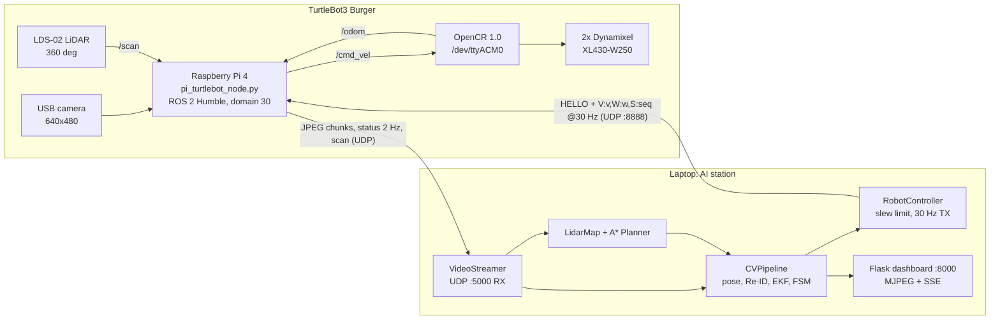

# Human-Following Mobile Robot — Project Report

**Course:** 23ECE436 Embedded Systems for Robotics
**Platform:** TurtleBot3 Burger (OpenCR 1.0, Raspberry Pi 4) with laptop edge compute
**Reference:** F. Rollo et al., *FollowMe: A Robust Person Following Framework Based on Visual Re-Identification and Gestures*, IEEE ARSO 2023
**Repository:** https://github.com/GSRISHANTH/Human-Following-Turtle-bot

---

## Abstract

The robot follows one enrolled person (the *owner*) at a set distance, ignores bystanders, and recovers on its own when the owner is lost from view. Following the FollowMe framework, the owner is enrolled and controlled by hand gestures and re-identified by appearance. All perception and control run on a laptop. The Raspberry Pi on the robot only streams the camera and LiDAR and forwards velocity commands to the OpenCR motor board. The owner's position is estimated by an Extended Kalman Filter that fuses a monocular camera (MediaPipe pose, pinhole range and bearing) with the 360° LiDAR. A PID controller with velocity feed-forward drives the robot. A reactive LiDAR layer and an A* planner on a live occupancy grid steer around obstacles. When the owner is lost, the robot first drives to where they were last seen and only then searches by rotating. On the development laptop (Ryzen 7 6800HS) the full pipeline runs at about 39 FPS. The 106 automated tests (unit, closed-loop simulation and UDP loopback) all pass.

---

## 1. System Architecture

### 1.1 Distribution of work

| Node | Runs | Does **not** run |
|---|---|---|
| **Laptop** (Windows/Linux, Python 3.10–3.14) | Pose estimation, Re-ID, distance and bearing, EKF, PID, state machine, gestures, LiDAR mapping, A* planning, avoidance, safety gating, Flask dashboard | Motor I/O |
| **Raspberry Pi 4** (Ubuntu 22.04, ROS 2 Humble) | Camera capture and JPEG/UDP streaming, LiDAR `/scan` and `/odom` forwarding, UDP command receiver, `/cmd_vel` publisher, command watchdog | Any vision or decision logic |
| **OpenCR 1.0** (STM32F7) | TurtleBot3 firmware: wheel velocity loop for the two Dynamixel servos, IMU, battery monitoring | Anything above `/cmd_vel` |

The Pi does as little as possible on purpose. Its CPU cannot run MediaPipe at a usable frame rate, and keeping it thin means every safety-relevant decision on the robot is a simple timeout that cannot itself hang.

### 1.2 Block diagram



### 1.3 Per-frame processing chain (laptop)

```
frame (UDP, newest wins) ─► resize to 480 px wide ─► MediaPipe PoseLandmarker (lite, VIDEO mode)
   ─► anatomical validity check ─► per-candidate HSV signature + multi-anchor distance
   ─► gesture recogniser (4-frame debounce) ─► owner Re-ID / ambiguity check
   ─► EKF fusion with LiDAR person cluster ─► state machine (follow / wait / recall / search)
   ─► PID + feed-forward ─► LiDAR avoidance (front, side, side keep-out) ─► safety monitor
   ─► RobotController (watchdog, LiDAR hard stop, slew-rate limiter) ─► UDP to Pi at 30 Hz
```

---

## 2. Hardware Specifications

| Component | Specification (manufacturer data) | Role in this project |
|---|---|---|
| **TurtleBot3 Burger** | 138 × 178 × 192 mm, about 1 kg; differential drive; max 0.22 m/s, 2.84 rad/s | Mobile base. Software caps: 0.22 m/s, 2.0 rad/s |
| Actuators | 2 × ROBOTIS Dynamixel XL430-W250-T | Wheel velocity control through OpenCR |
| Battery | 11.1 V 3S LiPo, 1800 mAh (safe range about 11.1–12.6 V) | Powers OpenCR, which powers the Pi |
| **OpenCR 1.0** | STM32F746 (ARM Cortex-M7, 216 MHz); 3-axis gyro, accelerometer and magnetometer IMU; USB-CDC link to the Pi | Runs TurtleBot3 firmware; reached through `turtlebot3_bringup` on `/dev/ttyACM0` |
| **Raspberry Pi 4 Model B** | Broadcom BCM2711, 4 × Cortex-A72 at 1.5 GHz; Wi-Fi 802.11ac | Camera, LiDAR and command bridge (`pi/`) |
| LiDAR | ROBOTIS LDS-02, 360°, about 0.16–8 m | `/scan` resampled to 360 one-degree bins (mm) for fusion and mapping |
| Camera | USB UVC, 640 × 480 at 25–30 FPS; horizontal FOV set to 57° (`CAMERA_HFOV_DEG`) | Pose, appearance and bearing |
| Laptop (development) | AMD Ryzen 7 6800HS, 8 cores / 16 threads, CPU only (no GPU used) | All AI and control |

---

## 3. Software Modules

| Module | Responsibility |
|---|---|
| [laptop/cv_pipeline.py](laptop/cv_pipeline.py) | Main per-frame engine: detection, Re-ID, fusion, state machine, recall and search |
| [laptop/appearance_model.py](laptop/appearance_model.py) | HSV signatures, similarity score, protected multi-template owner profile, ambiguity test |
| [laptop/gesture_recognizer.py](laptop/gesture_recognizer.py) | `FOLLOW_ME`, `WAIT`, `RELEASE`, `STOP_HALT` from landmarks, debounced |
| [laptop/ekf_person.py](laptop/ekf_person.py) | 4-state EKF of the owner's position and velocity in the robot frame, with χ² gating |
| [laptop/follow_controller.py](laptop/follow_controller.py) | Range and bearing PIDs with anti-windup and line-of-sight feed-forward |
| [laptop/lidar.py](laptop/lidar.py) | Scan conversion, clustering, person-cluster lookup, occupancy grid with scan matching, reactive avoidance |
| [laptop/navigation.py](laptop/navigation.py) | Inflated costmap and A* planner; person memory for recall after loss |
| [laptop/robot_controller.py](laptop/robot_controller.py) | Command watchdog, LiDAR hard stop, slew-rate limiting, 30 Hz UDP dispatch |
| [laptop/safety_monitor.py](laptop/safety_monitor.py) | Proximity, stop-gesture and visual ground-hazard gating |
| [laptop/app.py](laptop/app.py) | Flask dashboard: video, telemetry over SSE, operator controls and teleop |
| [pi/pi_turtlebot_node.py](pi/pi_turtlebot_node.py), [pi/tb_proto.py](pi/tb_proto.py) | Robot bridge and the shared UDP wire format |
| [hil/](hil/) | Hardware-in-the-loop bench: virtual Pi with a Burger kinematic plant and the laptop webcam |

---

## 4. Mathematical Models

### 4.1 Camera geometry and bearing

With image width $W$ (px) and horizontal field of view $\theta_{\text{HFOV}} = 57^\circ$, the pinhole focal length in pixels is

$$f_{px} = \frac{W/2}{\tan(\theta_{\text{HFOV}}/2)}$$

and a person whose torso centroid lies at column $c_x$ has bearing (positive to the left)

$$\beta_{cam} = -\arctan\!\left(\frac{c_x - W/2}{f_{px}}\right) + b_{cam}$$

where $b_{cam}$ is a learned bias, bounded to ±0.1 rad. While the LiDAR confirms the person, it adapts slowly: $b \leftarrow 0.97\,b + 0.03\,(\beta_{lidar} - \beta_{raw})$.

### 4.2 Monocular distance estimation

For a body segment of real length $L$ that spans $s$ pixels, the pinhole model gives $d = f_{px} L / s$. The pipeline uses three anatomical anchors from the MediaPipe landmarks and averages whichever are visible (landmark visibility > 0.35). Each constant $K_i = f_{px}L_i$ is calibrated at the 640 px reference width and rescaled to the processing width $W$:

| Anchor | Landmarks | Pixel span $s_i$ | $K_i$ (px·m) | Valid when |
|---|---|---|---|---|
| Shoulder width (≈ 0.44 m) | 11–12 | $\lVert p_{12}-p_{11}\rVert$ | 235 | $s > 15$ px |
| Pelvic width (≈ 0.30 m) | 23–24 | $\lVert p_{24}-p_{23}\rVert$ | 160 | $s > 15$ px |
| Torso height | 11/12 → 23/24 | $\max(\lvert y_{23}-y_{11}\rvert, \lvert y_{24}-y_{12}\rvert)$ | 230 | $s > 35$ px |

$$\hat d_{cam} = \operatorname{clip}\!\left(\frac{1}{n}\sum_{i=1}^{n}\frac{K_i}{s_i}\cdot\frac{W}{640},\; 0.35,\; 4.5\right)\text{ m}$$

If no anchor is usable, the bounding-box height is used instead: $\hat d = 320/h_{bbox}\cdot W/640$. Averaging the anchors reduces the error caused by any one of them: shoulder width shrinks when the person turns sideways, and torso height shrinks when they lean. Monocular range error grows with distance, so the EKF gives the camera range a standard deviation of $\sigma_r = 0.12\,d$. When the LiDAR range agrees, a scale factor $k_v \in [0.6, 1.6]$ is adapted ($k_v \leftarrow 0.98k_v + 0.02\,r_{lidar}/\hat d$), so the camera gradually calibrates itself against the LiDAR.

### 4.3 HSV appearance signature and Bhattacharyya distance

**Signature.** The upper-torso patch (between the shoulder and hip landmarks) is converted to HSV. A 2-D Hue–Saturation histogram is computed with $18 \times 16$ bins and L1-normalised, so $\sum_{i}H(i)=1$. Leaving out the V channel makes the signature robust to brightness changes. A second histogram is taken from the head region, together with two shape ratios (bounding-box aspect ratio and torso ratio).

**Bhattacharyya distance** (OpenCV `HISTCMP_BHATTACHARYYA`, $N = 288$ bins):

$$d_B(H_1,H_2)=\sqrt{\,1-\frac{1}{\sqrt{\bar H_1\,\bar H_2\,N^2}}\sum_{i=1}^{N}\sqrt{H_1(i)\,H_2(i)}\,}\qquad d_B\in[0,1]$$

$d_B = 0$ means identical colour distributions and $d_B = 1$ means no overlap. It is combined with the Pearson correlation $\rho$ (`HISTCMP_CORREL`), which rewards matching histogram *shape*:

$$S_{color} = 0.5\,\max(0,\,1-d_B) + 0.5\,\max(0,\,\rho)$$

The head similarity $S_{head}$ is computed the same way; if the head is not visible, $S_{head}=S_{color}$. The geometric similarity is $S_{geom}=0.6\,\frac{\min(a_1,a_2)}{\max(a_1,a_2)}+0.4\,\frac{\min(t_1,t_2)}{\max(t_1,t_2)}$. The overall score is

$$S = 0.70\,S_{color} + 0.18\,S_{head} + 0.12\,S_{geom},\qquad S \leftarrow \max(S,\,0.88\,S_{color})\ \text{if } S_{color}\ge 0.45$$

The second rule stops a turned head or a change in posture from dragging down a strong clothing match.

**Multi-template owner profile.** On enrollment an immutable *protected template* $T_0$ is stored. Further views (back, side, other distances) are added to a bank of up to 8 templates, but only while the track is alive, the owner is alone in the frame, and the match is at least 0.45. Template updates use an EMA with α ≤ 0.08, so the profile cannot drift towards a bystander. The owner score of a candidate $c$ is

$$S_{own}(c)=\max_{k\in\{0..K\}} S(T_k, c)$$

**Ambiguity.** If the two best candidates both reach 0.40 but differ by less than $\Delta = 0.08$, the state becomes `TARGET_AMBIGUOUS` and the robot stops rather than guessing.

**Re-acquisition gate (after loss).** A candidate is accepted again only when $S_{own}\ge\max(0.40,\,0.60\,\bar S)$, where $\bar S$ is the owner's running score while tracked. This must hold for 5 consecutive frames (3 frames, with the threshold lowered by 0.08, when the candidate is within the EKF-predicted bearing window). A near-certain match ($S\ge0.80$) is accepted immediately. While the track is alive, position continuity is the main evidence: the candidate must lie inside the EKF bearing gate and score at least $\max(0.25,\,0.5\,\bar S)$.

### 4.4 Extended Kalman Filter (owner state)

The state is the owner's position and ground velocity in the robot frame (x forward, y left): $\mathbf s=[p_x, p_y, u_x, u_y]^T$.

**Prediction** (constant-velocity person, with the robot's ego-motion $v, \omega$ removed over $\Delta t$):

$$\mathbf p' = R(-\omega\Delta t)\big(\mathbf p + \mathbf u\,\Delta t - [v\Delta t,\,0]^T\big),\qquad \mathbf u' = R(-\omega\Delta t)\,\mathbf u$$

This is linear in $\mathbf s$, so $F$ is exact. The process noise is a discrete white-noise acceleration model with $\sigma_a = 0.9$ m/s²:
$Q=\sigma_a^2\begin{bmatrix}\tfrac{\Delta t^4}{4}I & \tfrac{\Delta t^3}{2}I\\ \tfrac{\Delta t^3}{2}I & \Delta t^2 I\end{bmatrix}$.

**Measurement** (polar): $h(\mathbf s)=\big[\sqrt{p_x^2+p_y^2},\ \operatorname{atan2}(p_y,p_x)\big]^T$, with Jacobian

$$H=\begin{bmatrix}p_x/r & p_y/r & 0 & 0\\ -p_y/r^2 & p_x/r^2 & 0 & 0\end{bmatrix}$$

| Sensor | $\sigma_r$ | $\sigma_\beta$ |
|---|---|---|
| Camera | $0.12\,d$ | 1.5° |
| LiDAR person cluster | 0.05 m | 1.0° |

**Gating:** a measurement is rejected if its normalised innovation squared $\mathbf y^T S^{-1}\mathbf y > 11.3$ (above the 99% χ² point for 2 degrees of freedom, 9.21). The covariance update uses the Joseph form $P=(I-KH)P(I-KH)^T+KRK^T$ to keep it symmetric positive-definite. The estimated speed is clipped to 2 m/s. When there is no measurement, the filter coasts with the velocity decaying as $e^{-\Delta t/2}$, because a person who leaves the view usually slows down.

### 4.5 Follow controller (PID with feed-forward)

With $e_d = r - d^\*$ and $e_\beta = \beta$, where the controller steers at the EKF prediction 0.35 s ahead:

$$\omega = K_{p\beta}e_\beta + K_{i\beta}\!\int e_\beta + K_{d\beta}\dot\beta_{EKF}$$
$$v = \Big[K_{pd}e_d + K_{id}\!\int e_d + K_{dd}\dot r_{EKF} + K_{ff}\,\max(0,u_{los})\,\phi(r)\Big]\cos^2\!\big(\min(|\beta|,\tfrac{\pi}{2})\big)$$

| Gain | $K_p$ | $K_i$ | $K_d$ |
|---|---|---|---|
| Range | 0.45 | 0.04 | 0.20 |
| Bearing | 2.20 | 0.05 | 0.35 |

$K_{ff}=0.8$, and $\phi(r)$ fades the feed-forward to zero within 0.15 m inside the set distance, so a person who stops cannot drag the robot in. The derivative terms use the EKF's range and bearing rates instead of differencing noisy measurements. The integrators are clamped and only integrate while the output is not saturated (anti-windup). The $\cos^2$ factor makes the robot turn before driving when the owner is far off-axis. Outputs are limited to $v\in[0,0.22]$ m/s and $|\omega|\le2.0$ rad/s. Commands between 0.06 and 0.08 m/s are raised to 0.08 m/s to overcome static friction, and smaller ones are set to zero. The `RobotController` then slew-limits the commands to 1.6 m/s² and 8 rad/s².

### 4.6 Distance hysteresis (follow and wait)

With set distance $d^\*$ = 1.20 m (adjustable from the dashboard, minimum 0.60 m):

$$d_{stop}=\max(0.4,\,d^\*-0.10)=1.10\text{ m},\qquad d_{resume}=d^\*+0.15=1.35\text{ m}$$

- $r \le d_{stop}$ → `WAIT_FOR_OWNER_MOVEMENT`: $v = 0$; the robot only rotates to keep the owner centred, with a 3° deadband.
- $d_{stop} < r < d_{resume}$ → keep the current state (25 cm hysteresis band, no chatter).
- $r \ge d_{resume}$ for **3 consecutive frames** → `FOLLOWING`.

While the owner stands still within $d_{stop}$, the robot waits indefinitely and never starts a search or switches to another person.

### 4.7 LiDAR reactive avoidance

The scan is reduced to the nearest return in three sectors: front ±25°, left 25°–80°, right −80°–−25°. Beams that fall on the tracked owner are masked out. For front distance $d_f$:

| Condition | Action |
|---|---|
| $d_f < 0.30$ m | $v \le 0$; turn toward the freer side (`LIDAR_STOP`) |
| $0.30 \le d_f < 0.85$ m | $v \leftarrow v\cdot\max(0.25,k)$, $\omega \mathrel{+}= \text{bias}\,(1-k)\,0.7$, with $k=\frac{d_f-0.30}{0.55}$ |
| side $d_s < 0.40$ m | nudge $\omega$ away by $0.5\,(0.40-d_s)/0.40$ |
| side $d_s < 0.20$ m (**keep-out**) | $\omega$ may not turn toward that side; push away by $0.6(1-d_s/0.20)$; $v \leftarrow v\cdot\max(0.35,\,d_s/0.20)$ |
| front ±15° raw $< 0.20$ m | `RobotController` hard stop: forward target and current velocity forced to 0, independent of vision |

### 4.8 Path planning on the LiDAR map

The `LidarMap` keeps a log-odds occupancy grid (0.05 m cells, 12 × 12 m) and corrects odometry drift by scan matching. The planner downsamples it to 0.10 m cells and inflates obstacles by 0.22 m (robot radius 0.105 m plus margin). The owner's blob and a 0.30 m bubble around the robot are cleared, so that neither blocks the plan. A hard core of one cell around every real return is kept inside that bubble. The goal is the point $d^\*$ short of the owner. If the straight line to it is free, the plan is `DIRECT`. Otherwise A* (8-connected, no corner cutting, with an extra cost near walls) is run and smoothed, and the controller steers at a waypoint 0.6 m along the path (`DETOUR`).

**Recall after loss.** `PersonMemory` stores the owner's last map-frame position. For up to 25 s the robot drives there at 0.15 m/s via the planner, with avoidance active. Throughout, the LiDAR checks for a person-sized cluster near the EKF prediction (gate 0.5 m, growing by 0.25 m/s of loss time, capped at +1.0 m), and the camera Re-ID gate keeps running. Only if the remembered spot is empty does the 3-phase search start:

1. **Predicted:** turn toward the EKF's last bearing.
2. **Sweep:** widening oscillation up to ±110° for 6 s.
3. **Scan:** full 360° at 0.8 rad/s in the owner's exit direction, then halt.

A search rotation is suppressed if the side it turns toward has an obstacle within 0.22 m.

---

## 5. State Machine

### 5.1 States

| State | Meaning | Motion |
|---|---|---|
| `IDLE` | No owner enrolled | Stopped |
| `OWNER_LOCKED` | Owner just enrolled; profile and protected template created | Stopped (transient, one frame) |
| `FOLLOWING` | Owner tracked, $r > d_{stop}$ | PID + avoidance |
| `WAIT_FOR_OWNER_MOVEMENT` | Owner within $d_{stop}$, or following paused by `WAIT` | Rotate in place to face owner only |
| `TARGET_TEMPORARILY_LOST` | Owner not in camera or LiDAR; 0.4 s hold, or waiting for the first plan | Stopped |
| `RECALLING_LAST_POSITION` | Driving to the remembered position via A* | ≤ 0.15 m/s + avoidance |
| `SEARCH_ROTATING` | 3-phase rotational search | Rotation only, ≤ 1.0 rad/s |
| `TARGET_AMBIGUOUS` | Two candidates indistinguishable ($\Delta S < 0.08$) | Stopped |
| `SAFETY_STOP` | `STOP_HALT` gesture held | Stopped |
| `OWNER_RELEASED` | `RELEASE` gesture or button; profile deleted | Stopped |
| `MANUAL_CONTROL` | Dashboard teleoperation (controller mode `MANUAL`); autonomous commands ignored | Operator |

`OWNER_ENROLLMENT` is declared in `Config` but no code path assigns it: enrollment happens within a single frame and goes straight to `OWNER_LOCKED`.

### 5.2 Transition table

| From | Event / guard | To |
|---|---|---|
| `IDLE` | `FOLLOW_ME` gesture by a valid pose, or dashboard *Enroll* | `OWNER_LOCKED` |
| `OWNER_LOCKED` | next frame, following enabled | `FOLLOWING` / `WAIT_FOR_OWNER_MOVEMENT` (by distance) |
| `FOLLOWING` | $r \le d_{stop}$ | `WAIT_FOR_OWNER_MOVEMENT` |
| `WAIT_FOR_OWNER_MOVEMENT` | $r \ge d_{resume}$ for 3 frames, following enabled | `FOLLOWING` |
| any following state | `WAIT` gesture | `WAIT_FOR_OWNER_MOVEMENT` (following disabled) |
| `WAIT_FOR_OWNER_MOVEMENT` (paused) | `FOLLOW_ME` gesture | `FOLLOWING` |
| `FOLLOWING` / `WAIT…` | owner absent from camera; LiDAR cluster still at EKF prediction | same state, *LiDAR-only tracking* (≤ 12 s) |
| `FOLLOWING` / `WAIT…` | owner absent from camera **and** LiDAR | `TARGET_TEMPORARILY_LOST` |
| `TARGET_TEMPORARILY_LOST` | after 0.4 s, memory plan is `DIRECT`/`DETOUR` | `RECALLING_LAST_POSITION` |
| `RECALLING_LAST_POSITION` | LiDAR cluster near prediction (`MEMORY_RELOCK`) or camera Re-ID passes | `FOLLOWING` / `WAIT…` |
| `RECALLING_LAST_POSITION` | reached the spot, no path, off the map, or 25 s elapsed | `SEARCH_ROTATING` |
| `SEARCH_ROTATING` | Re-ID gate passes (§4.3) | `FOLLOWING` / `WAIT…` |
| `SEARCH_ROTATING` | 360° covered or 30 s | `TARGET_TEMPORARILY_LOST` (halted) |
| any tracked state | top two candidates ≥ 0.40 and within 0.08 | `TARGET_AMBIGUOUS` |
| any | `STOP_HALT` (both hands up) | `SAFETY_STOP` (held while the gesture persists) |
| any with owner | `RELEASE` (crossed arms) or dashboard *Release* | `OWNER_RELEASED` → `IDLE` |

### 5.3 Gestures (MediaPipe landmarks, normalised image coordinates, y grows downwards)

| Gesture | Rule | Action |
|---|---|---|
| `STOP_HALT` | Both wrists ≥ 0.08 above their shoulders | Emergency stop (highest priority) |
| `RELEASE` | $(x_{wl}-x_{wr})(x_{sl}-x_{sr}) < -0.005$ (wrists crossed) with both wrists at chest height | Release owner |
| `FOLLOW_ME` | Either wrist ≥ 0.04 above the nose | Enroll, or resume following |
| `WAIT` | Wrist between nose and shoulder height and above its elbow (upright forearm) | Pause following |

Gestures are evaluated in the priority order above and must persist for 4 consecutive frames before they fire. A held gesture fires only once; it can fire again only after the hands return to a neutral pose. (`Config.GESTURE_COOLDOWN_SEC` is declared but not currently used.)

---

## 6. Safety Boundaries

The layers are independent: each one can stop the robot even if every layer above it fails.

| # | Layer | Where | Boundary | Response |
|---|---|---|---|---|
| 1 | Pose validity | Laptop | ≥ 6 confident landmarks, both shoulders or both hips, nose above shoulders, hips below shoulders, plausible shoulder width | Non-humans (chairs, coats) never become candidates |
| 2 | Identity | Laptop | Re-ID gates (§4.3), ambiguity Δ < 0.08 | Bystanders ignored; stop when ambiguous |
| 3 | Human proximity | Laptop `SafetyMonitor` | $d < 0.55$ m | `CRITICAL_PROXIMITY_STOP`, motion blocked |
| 4 | Stop gesture | Laptop | `STOP_HALT` | Motion blocked while held |
| 5 | LiDAR reactive | Laptop | front < 0.30 m stop, < 0.85 m slow; side < 0.40 m nudge, < 0.20 m keep-out | Bend or slow the command |
| 6 | LiDAR hard stop | Laptop `RobotController` | ±15° raw < 0.20 m, scan younger than 0.6 s | Forward velocity forced to 0 |
| 7 | Speed and acceleration limits | Laptop | 0.22 m/s, 2.0 rad/s, 1.6 m/s², 8 rad/s² | Clamp and slew |
| 8 | Laptop command watchdog | Laptop | No pipeline update for 0.60 s | Target velocity → 0 |
| 9 | **Pi command watchdog** | Raspberry Pi | No UDP command for **0.35 s** (≈ 10 packets at 30 Hz) | `/cmd_vel` = 0 published to OpenCR |
| 10 | Stale video | Laptop | Frame older than 0.8 s | Stream treated as lost |
| 11 | Search limits | Laptop | Recall ≤ 25 s, search ≤ 30 s / 360° | Halt and wait for the owner |
| 12 | Test isolation | Tests | `tests/__init__.py` and `conftest.py` force `COMMAND_MODE="mock"`, `PI_IP=127.0.0.1` | The test suite can never drive the real robot |

---

## 7. Communication Protocol

| Channel | Direction | Transport | Format | Rate |
|---|---|---|---|---|
| Handshake | Laptop → Pi :8888 | UDP | `HELLO\n` from the laptop's video socket | 2 Hz |
| Velocity | Laptop → Pi :8888 | UDP | `V:<m/s>,W:<rad/s>,S:<seq>\n` (ASCII) | 30 Hz, sent even when zero (heartbeat) |
| Video | Pi → laptop :5000 | UDP | Header `!2sBIHHd` (magic `TB`, type, frame id, chunk i/n, capture time) + ≤ 1200 B JPEG chunk | Camera rate; incomplete frames dropped, newest frame wins |
| Status | Pi → laptop :5000 | UDP | Header + JSON (ROS mode, subscribers, torque, camera FPS, command age, …) | 2 Hz |
| Scan | Pi → laptop :5000 | UDP | Header + odom (x, y, yaw) + 360 × uint16 mm | LiDAR rate (~5–10 Hz) |
| Dashboard | Laptop → browser :8000 | HTTP | MJPEG video + Server-Sent Events telemetry | — |

The Pi learns the laptop's address from the `HELLO` source, so only the laptop needs to be configured (`PI_IP` in `laptop/config.py` or the `PI_IP` environment variable). Sequence numbers start from the wall clock, so a restarted laptop is never treated as older than the Pi's last packet. Both endpoints disable Windows' `SIO_UDP_CONNRESET`, so an ICMP port-unreachable message cannot kill the receive loop.

---

## 8. Experimental Results and Benchmarks

All figures below were measured on the development laptop (AMD Ryzen 7 6800HS, Windows 11, Python 3.14.6, mediapipe 1.1.1, OpenCV 5.0, CPU only). §8.1–8.4 are software and simulation results; §8.5 lists the physical trials still to be recorded on the robot.

### 8.1 Automated test suite

`python -m unittest discover tests` → **Ran 106 tests — OK** (3 consecutive full runs, about 25 s each).

| File | Tests | Covers |
|---|---|---|
| `test_behaviors.py` | 24 | State machine, follow/wait hysteresis, Re-ID gates, recall and search behaviour |
| `test_navigation.py` | 22 | Occupancy grid, scan matching, A* detours, person memory |
| `test_system.py` | 16 | End-to-end scenarios: gestures, identity protection, safety |
| `test_lidar.py` | 13 | Scan conversion, clustering, sectors, avoidance |
| `test_follow_sim.py` | 11 | Closed-loop EKF + PID against walking-person trajectories |
| `test_udp_link.py` | 11 | Wire format, packet loss and reordering, **real Pi node ↔ laptop over loopback** |
| `test_fusion_pipeline.py` | 4 | Camera + LiDAR fusion inside the real pipeline |
| `test_hil_plant.py` | 4 | Burger kinematic plant used by the HIL bench |
| `test_recall_sim.py` | 1 | Owner hides behind a wall; robot detours through the gap and re-locks |

### 8.2 Closed-loop following (simulation)

These use the same plant the gains were tuned on: Burger kinematics, slew limits, 0.15 s perception latency and 0.10 s command latency, camera at 12 Hz with $\sigma_r = 0.12d$ and 1.5°, LiDAR at 10 Hz with 5 cm. The target distance is 1.20 m; statistics exclude the first 3 s.

| Scenario | Range RMS error | Min range | Max \|bearing\| | Max $v$ |
|---|---|---|---|---|
| Walk + arc turn, LiDAR + camera | **0.119 m** | 1.10 m | 3.8° | 0.220 m/s |
| Walk + arc turn, camera only | 0.167 m | 1.07 m | 3.8° | 0.220 m/s |
| Sharp 90° turn, LiDAR + camera | 0.106 m | 1.16 m | 4.7° | 0.220 m/s |

LiDAR fusion reduces the range error by about 29% compared with camera-only operation. The robot never closes inside its stop distance by more than 3 cm and never exceeds the Burger's speed limit.

### 8.3 Obstacle clearance in the recall scenario (before and after the final fix)

In `test_recall_sim.py` the owner walks behind a wall that has a single gap. During final validation this test failed: the robot passed the wall corner with **0.07 m** clearance from the LiDAR centre, which is less than the Burger's 0.105 m footprint radius and so a collision on real hardware. There were two causes:

1. The planner's free bubble around the robot also erased the inflation of a nearby wall corner, so the smoothed path cut the corner.
2. The side avoidance was only a bias, and the PID turning toward the owner overpowered it.

The fix keeps a hard core around real returns inside the bubble (§4.8) and adds the side keep-out zone (§4.7):

| | Min clearance (4 runs) | Re-lock time |
|---|---|---|
| Before | 0.07–0.09 m (collision) | 6.1–6.6 s |
| After | **0.15–0.17 m** | 5.7–5.9 s |

### 8.4 Computational performance (laptop, per call)

| Stage | Median | p95 |
|---|---|---|
| Full `CVPipeline.process_frame`, 640 × 480 (MediaPipe lite + Re-ID + EKF + FSM) | **25.9 ms (≈ 39 FPS)** | 28.5 ms |
| HSV signature extraction | 0.55 ms | 0.98 ms |
| Owner match against 1 protected + 8 templates | 0.06 ms | 0.09 ms |
| EKF predict + update | 0.08 ms | 0.15 ms |
| LiDAR scan → sectors + clusters | 0.69 ms | 1.25 ms |
| A* detour plan (wall scenario) | 7.9 ms | 9.2 ms |

The pipeline uses about 65% of the 40 ms budget at 25 FPS. The planner runs at 4 Hz on its own thread.

### 8.5 Physical trials (to be recorded on the robot)

| Trial | Metric | Result |
|---|---|---|
| Straight-line follow, 10 m corridor | Mean / SD distance vs 1.20 m | _pending_ |
| Stop-and-wait (owner stops 10 times) | Overshoot below 1.10 m; false resumes | _pending_ |
| Bystander crossing between robot and owner (10 trials) | Identity switches | _pending_ |
| Owner leaves view left/right (10 trials) | Re-acquisition rate and time | _pending_ |
| Gesture recognition (20 per gesture) | True-positive rate, false triggers per minute | _pending_ |
| Link loss (pull Wi-Fi) | Time from loss to wheels stopped (expected ≤ 0.35 s + 1 frame) | _pending_ |
| End-to-end latency (laptop timestamp → Pi `cmd_age`) | ms | _pending_ |

---

## 9. Pre-Flight Hardware Checklist

| ✓ | Check | Pass criterion |
|---|---|---|
| ☐ | LiPo voltage at the OpenCR connector | 11.1–12.6 V; stop below 11.0 V (OpenCR buzzer warns at low voltage) |
| ☐ | OpenCR power switch on; Pi booted | OpenCR LEDs lit; `ssh ubuntu@<PI_IP>` works |
| ☐ | Same network | `ping <PI_IP>` from the laptop succeeds; laptop and Pi on the same subnet |
| ☐ | `PI_IP` set | `laptop/config.py` or `$env:PI_IP` matches `hostname -I` on the Pi |
| ☐ | OpenCR serial | `ls /dev/ttyACM0` on the Pi |
| ☐ | Bringup and torque | `bash ~/pi/start_robot.sh` prints *Motor torque enabled*; `ros2 topic list` shows `/cmd_vel`, `/scan`, `/odom` (`ROS_DOMAIN_ID=30`) |
| ☐ | Torque test (wheels off the ground) | `python3 pi_turtlebot_node.py --test` spins both wheels the same way, then stops |
| ☐ | Camera angle | Owner at 1.2 m visible from shoulders to hips; horizon at roughly the upper third; lens clean |
| ☐ | LiDAR | Dashboard map shows the room walls; scan rate > 4 Hz in Link Health |
| ☐ | Firewall | Windows allows inbound UDP 5000 for Python (video appears on the dashboard) |
| ☐ | Watchdog | With the robot rolling slowly in MANUAL mode, close the dashboard: the wheels stop within about 0.4 s |
| ☐ | E-stop | Dashboard E-STOP button and the `STOP_HALT` gesture both halt the robot |

---

## 10. Limitations and Future Work

- **Monocular range:** the anthropometric constants assume an adult of average build. LiDAR fusion corrects this online, but camera-only operation (LiDAR blocked) is about 40% less accurate (§8.2).
- **Single pose per frame:** MediaPipe is configured with `num_poses=1`, so only one person yields a candidate per frame. The HOG detector is initialised but does not currently add candidates. Running several poses, or a HOG/YOLO detector feeding Re-ID, would make bystander rejection and ambiguity detection effective in crowds.
- **Colour-based Re-ID:** H–S histograms fail when two people wear similar clothing; this is detected as ambiguous, but not resolved. A learned embedding (for example OSNet) would separate them.
- **Unused code:** `laptop/pose_tracker.py` is a legacy single-person tracker that the pipeline no longer imports. It references `Config` keys that no longer exist and can be removed.
- **Physical validation:** §8.5 still has to be recorded on the robot.

---

## 11. How to Reproduce

```powershell
py -3.14 -m pip install -r requirements.txt
py -3.14 -m unittest discover tests        # 106 tests, OK
py -3.14 app.py                            # dashboard at http://localhost:8000
run_hil.bat                                # webcam + simulated Burger, no hardware needed
```

On the Pi: `python3 -m pip install --user -r ~/pi/requirements.txt`, then `bash ~/pi/start_robot.sh`.
