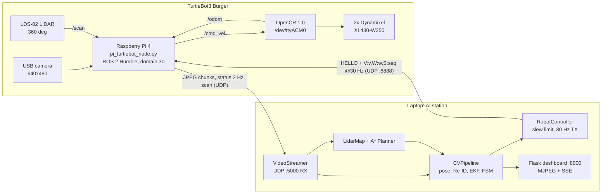

# Human-Following Mobile Robot — Project Report

**Course:** 23ECE436 Embedded Systems for Robotics
**Platform:** TurtleBot3 Burger (OpenCR 1.0, Raspberry Pi 4) with laptop edge compute
**Reference:** F. Rollo et al., *FollowMe: A Robust Person Following Framework Based on Visual Re-Identification and Gestures*, IEEE ARSO 2023
**Repository:** https://github.com/GSRISHANTH/Human-Following-Turtle-bot

---

## Abstract

The robot follows one enrolled person (the *owner*) at a set distance, ignores bystanders, and recovers on its own when the owner is lost from view. Following the FollowMe framework, the owner is enrolled and controlled by hand gestures and re-identified by appearance. All perception and control run on a laptop. The Raspberry Pi on the robot only streams the camera and LiDAR and forwards velocity commands to the OpenCR motor board. The owner's position is estimated by an Extended Kalman Filter that fuses a monocular camera (MediaPipe pose, pinhole range and bearing) with the 360° LiDAR. A PID controller with velocity feed-forward drives the robot. A reactive LiDAR layer and an A* planner on a live occupancy grid steer around obstacles. When the owner is lost, the robot first drives to where they were last seen and only then searches by rotating. On the development laptop (Ryzen 7 6800HS) the full pipeline runs at about 39 FPS. The 106 automated tests (unit, closed-loop simulation and UDP loopback) all pass.

---

## 1. System Architecture

### 1.1 Distribution of work

| Node | Runs | Does **not** run |
|---|---|---|
| **Laptop** (Windows/Linux, Python 3.10–3.14) | Pose estimation, Re-ID, distance and bearing, EKF, PID, state machine, gestures, LiDAR mapping, A* planning, avoidance, safety gating, Flask dashboard | Motor I/O |
| **Raspberry Pi 4** (Ubuntu 22.04, ROS 2 Humble) | Camera capture and JPEG/UDP streaming, LiDAR `/scan` and `/odom` forwarding, UDP command receiver, `/cmd_vel` publisher, command watchdog | Any vision or decision logic |
| **OpenCR 1.0** (STM32F7) | TurtleBot3 firmware: wheel velocity loop for the two Dynamixel servos, IMU, battery monitoring | Anything above `/cmd_vel` |

The Pi does as little as possible on purpose. Its CPU cannot run MediaPipe at a usable frame rate, and keeping it thin means every safety-relevant decision on the robot is a simple timeout that cannot itself hang.

### 1.2 Block diagram



### 1.3 Per-frame processing chain (laptop)

```
frame (UDP, newest wins) ─► resize to 480 px wide ─► MediaPipe PoseLandmarker (lite, VIDEO mode)
   ─► anatomical validity check ─► per-candidate HSV signature + multi-anchor distance
   ─► gesture recogniser (4-frame debounce) ─► owner Re-ID / ambiguity check
   ─► EKF fusion with LiDAR person cluster ─► state machine (follow / wait / recall / search)
   ─► PID + feed-forward ─► LiDAR avoidance (front, side, side keep-out) ─► safety monitor
   ─► RobotController (watchdog, LiDAR hard stop, slew-rate limiter) ─► UDP to Pi at 30 Hz
```

---

## 2. Hardware Specifications

| Component | Specification (manufacturer data) | Role in this project |
|---|---|---|
| **TurtleBot3 Burger** | 138 × 178 × 192 mm, about 1 kg; differential drive; max 0.22 m/s, 2.84 rad/s | Mobile base. Software caps: 0.22 m/s, 2.0 rad/s |
| Actuators | 2 × ROBOTIS Dynamixel XL430-W250-T | Wheel velocity control through OpenCR |
| Battery | 11.1 V 3S LiPo, 1800 mAh (safe range about 11.1–12.6 V) | Powers OpenCR, which powers the Pi |
| **OpenCR 1.0** | STM32F746 (ARM Cortex-M7, 216 MHz); 3-axis gyro, accelerometer and magnetometer IMU; USB-CDC link to the Pi | Runs TurtleBot3 firmware; reached through `turtlebot3_bringup` on `/dev/ttyACM0` |
| **Raspberry Pi 4 Model B** | Broadcom BCM2711, 4 × Cortex-A72 at 1.5 GHz; Wi-Fi 802.11ac | Camera, LiDAR and command bridge (`pi/`) |
| LiDAR | ROBOTIS LDS-02, 360°, about 0.16–8 m | `/scan` resampled to 360 one-degree bins (mm) for fusion and mapping |
| Camera | USB UVC, 640 × 480 at 25–30 FPS; horizontal FOV set to 57° (`CAMERA_HFOV_DEG`) | Pose, appearance and bearing |
| Laptop (development) | AMD Ryzen 7 6800HS, 8 cores / 16 threads, CPU only (no GPU used) | All AI and control |

---

## 3. Software Modules

| Module | Responsibility |
|---|---|
| [laptop/cv_pipeline.py](laptop/cv_pipeline.py) | Main per-frame engine: detection, Re-ID, fusion, state machine, recall and search |
| [laptop/appearance_model.py](laptop/appearance_model.py) | HSV signatures, similarity score, protected multi-template owner profile, ambiguity test |
| [laptop/gesture_recognizer.py](laptop/gesture_recognizer.py) | `FOLLOW_ME`, `WAIT`, `RELEASE`, `STOP_HALT` from landmarks, debounced |
| [laptop/ekf_person.py](laptop/ekf_person.py) | 4-state EKF of the owner's position and velocity in the robot frame, with χ² gating |
| [laptop/follow_controller.py](laptop/follow_controller.py) | Range and bearing PIDs with anti-windup and line-of-sight feed-forward |
| [laptop/lidar.py](laptop/lidar.py) | Scan conversion, clustering, person-cluster lookup, occupancy grid with scan matching, reactive avoidance |
| [laptop/navigation.py](laptop/navigation.py) | Inflated costmap and A* planner; person memory for recall after loss |
| [laptop/robot_controller.py](laptop/robot_controller.py) | Command watchdog, LiDAR hard stop, slew-rate limiting, 30 Hz UDP dispatch |
| [laptop/safety_monitor.py](laptop/safety_monitor.py) | Proximity, stop-gesture and visual ground-hazard gating |
| [laptop/app.py](laptop/app.py) | Flask dashboard: video, telemetry over SSE, operator controls and teleop |
| [pi/pi_turtlebot_node.py](pi/pi_turtlebot_node.py), [pi/tb_proto.py](pi/tb_proto.py) | Robot bridge and the shared UDP wire format |
| [hil/](hil/) | Hardware-in-the-loop bench: virtual Pi with a Burger kinematic plant and the laptop webcam |

---

## 4. Mathematical Models

### 4.1 Camera geometry and bearing

With image width $W$ (px) and horizontal field of view $\theta_{\text{HFOV}} = 57^\circ$, the pinhole focal length in pixels is

$$f_{px} = \frac{W/2}{\tan(\theta_{\text{HFOV}}/2)}$$

and a person whose torso centroid lies at column $c_x$ has bearing (positive to the left)

$$\beta_{cam} = -\arctan\!\left(\frac{c_x - W/2}{f_{px}}\right) + b_{cam}$$

where $b_{cam}$ is a learned bias, bounded to ±0.1 rad. While the LiDAR confirms the person, it adapts slowly: $b \leftarrow 0.97\,b + 0.03\,(\beta_{lidar} - \beta_{raw})$.

### 4.2 Monocular distance estimation

For a body segment of real length $L$ that spans $s$ pixels, the pinhole model gives $d = f_{px} L / s$. The pipeline uses three anatomical anchors from the MediaPipe landmarks and averages whichever are visible (landmark visibility > 0.35). Each constant $K_i = f_{px}L_i$ is calibrated at the 640 px reference width and rescaled to the processing width $W$:

| Anchor | Landmarks | Pixel span $s_i$ | $K_i$ (px·m) | Valid when |
|---|---|---|---|---|
| Shoulder width (≈ 0.44 m) | 11–12 | $\lVert p_{12}-p_{11}\rVert$ | 235 | $s > 15$ px |
| Pelvic width (≈ 0.30 m) | 23–24 | $\lVert p_{24}-p_{23}\rVert$ | 160 | $s > 15$ px |
| Torso height | 11/12 → 23/24 | $\max(\lvert y_{23}-y_{11}\rvert, \lvert y_{24}-y_{12}\rvert)$ | 230 | $s > 35$ px |

$$\hat d_{cam} = \operatorname{clip}\!\left(\frac{1}{n}\sum_{i=1}^{n}\frac{K_i}{s_i}\cdot\frac{W}{640},\; 0.35,\; 4.5\right)\text{ m}$$

Each constant is $K_i = f_{px}\,L_i$ with the real size $L_i$ taken from `Config` (`PERSON_SHOULDER_M` = 0.40, `PERSON_HIP_M` = 0.27, `PERSON_TORSO_M` = 0.39), so changing the camera FOV or resolution needs no new constants; the result is multiplied by `DISTANCE_SCALE` (dashboard calibration). If no anchor is usable, the bounding-box height is used instead ($L$ = `PERSON_BOX_M` = 0.54 m). Averaging the anchors reduces the error caused by any one of them: shoulder width shrinks when the person turns sideways, and torso height shrinks when they lean. Monocular range error grows with distance, so the EKF gives the camera range a standard deviation of $\sigma_r = 0.12\,d$. When the LiDAR range agrees, a scale factor $k_v \in [0.6, 1.6]$ is adapted ($k_v \leftarrow 0.98k_v + 0.02\,r_{lidar}/\hat d$), so the camera gradually calibrates itself against the LiDAR.

### 4.3 HSV appearance signature and Bhattacharyya distance

**Signature.** The upper-torso patch (between the shoulder and hip landmarks) is converted to HSV. A 2-D Hue–Saturation histogram is computed with $18 \times 16$ bins and L1-normalised, so $\sum_{i}H(i)=1$. Leaving out the V channel makes the signature robust to brightness changes. A second histogram is taken from the head region, together with two shape ratios (bounding-box aspect ratio and torso ratio).

**Bhattacharyya distance** (OpenCV `HISTCMP_BHATTACHARYYA`, $N = 288$ bins):

$$d_B(H_1,H_2)=\sqrt{\,1-\frac{1}{\sqrt{\bar H_1\,\bar H_2\,N^2}}\sum_{i=1}^{N}\sqrt{H_1(i)\,H_2(i)}\,}\qquad d_B\in[0,1]$$

$d_B = 0$ means identical colour distributions and $d_B = 1$ means no overlap. It is combined with the Pearson correlation $\rho$ (`HISTCMP_CORREL`), which rewards matching histogram *shape*:

$$S_{color} = 0.5\,\max(0,\,1-d_B) + 0.5\,\max(0,\,\rho)$$

The head similarity $S_{head}$ is computed the same way; if the head is not visible, $S_{head}=S_{color}$. The geometric similarity is $S_{geom}=0.6\,\frac{\min(a_1,a_2)}{\max(a_1,a_2)}+0.4\,\frac{\min(t_1,t_2)}{\max(t_1,t_2)}$. The overall score is

$$S = 0.70\,S_{color} + 0.18\,S_{head} + 0.12\,S_{geom},\qquad S \leftarrow \max(S,\,0.88\,S_{color})\ \text{if } S_{color}\ge 0.45$$

The second rule stops a turned head or a change in posture from dragging down a strong clothing match.

**Multi-template owner profile.** On enrollment an immutable *protected template* $T_0$ is stored. Further views (back, side, other distances) are added to a bank of up to 8 templates, but only while the track is alive, the owner is alone in the frame, and the match is at least 0.45. Template updates use an EMA with α ≤ 0.08, so the profile cannot drift towards a bystander. The owner score of a candidate $c$ is

$$S_{own}(c)=\max_{k\in\{0..K\}} S(T_k, c)$$

**Ambiguity.** If the two best candidates both reach 0.40 but differ by less than $\Delta = 0.08$, the state becomes `TARGET_AMBIGUOUS` and the robot stops rather than guessing.

**Re-acquisition gate (after loss).** A candidate is accepted again only when $S_{own}\ge\max(0.40,\,0.60\,\bar S)$, where $\bar S$ is the owner's running score while tracked. This must hold for 5 consecutive frames (3 frames, with the threshold lowered by 0.08, when the candidate is within the EKF-predicted bearing window). A near-certain match ($S\ge0.80$) is accepted immediately. While the track is alive, position continuity is the main evidence: the candidate must lie inside the EKF bearing gate and score at least $\max(0.25,\,0.5\,\bar S)$.

### 4.4 Extended Kalman Filter (owner state)

The state is the owner's position and ground velocity in the robot frame (x forward, y left): $\mathbf s=[p_x, p_y, u_x, u_y]^T$.

**Prediction** (constant-velocity person, with the robot's ego-motion $v, \omega$ removed over $\Delta t$):

$$\mathbf p' = R(-\omega\Delta t)\big(\mathbf p + \mathbf u\,\Delta t - [v\Delta t,\,0]^T\big),\qquad \mathbf u' = R(-\omega\Delta t)\,\mathbf u$$

This is linear in $\mathbf s$, so $F$ is exact. The process noise is a discrete white-noise acceleration model with $\sigma_a = 0.9$ m/s²:
$Q=\sigma_a^2\begin{bmatrix}\tfrac{\Delta t^4}{4}I & \tfrac{\Delta t^3}{2}I\\ \tfrac{\Delta t^3}{2}I & \Delta t^2 I\end{bmatrix}$.

**Measurement** (polar): $h(\mathbf s)=\big[\sqrt{p_x^2+p_y^2},\ \operatorname{atan2}(p_y,p_x)\big]^T$, with Jacobian

$$H=\begin{bmatrix}p_x/r & p_y/r & 0 & 0\\ -p_y/r^2 & p_x/r^2 & 0 & 0\end{bmatrix}$$

| Sensor | $\sigma_r$ | $\sigma_\beta$ |
|---|---|---|
| Camera | $0.12\,d$ | 1.5° |
| LiDAR person cluster | 0.05 m | 1.0° |

**Gating:** a measurement is rejected if its normalised innovation squared $\mathbf y^T S^{-1}\mathbf y > 11.3$ (above the 99% χ² point for 2 degrees of freedom, 9.21). The covariance update uses the Joseph form $P=(I-KH)P(I-KH)^T+KRK^T$ to keep it symmetric positive-definite. The estimated speed is clipped to 2 m/s. When there is no measurement, the filter coasts with the velocity decaying as $e^{-\Delta t/2}$, because a person who leaves the view usually slows down.

### 4.5 Follow controller (PID with feed-forward)

With $e_d = r - d^\*$ and $e_\beta = \beta$, where the controller steers at the EKF prediction 0.35 s ahead:

$$\omega = K_{p\beta}e_\beta + K_{i\beta}\!\int e_\beta + K_{d\beta}\dot\beta_{EKF}$$
$$v = \Big[K_{pd}e_d + K_{id}\!\int e_d + K_{dd}\dot r_{EKF} + K_{ff}\,\max(0,u_{los})\,\phi(r)\Big]\cos^2\!\big(\min(|\beta|,\tfrac{\pi}{2})\big)$$

| Gain | $K_p$ | $K_i$ | $K_d$ |
|---|---|---|---|
| Range | 0.45 | 0.04 | 0.20 |
| Bearing | 2.20 | 0.05 | 0.35 |

$K_{ff}=0.8$, and $\phi(r)$ fades the feed-forward to zero within 0.15 m inside the set distance, so a person who stops cannot drag the robot in. The derivative terms use the EKF's range and bearing rates instead of differencing noisy measurements. The integrators are clamped and only integrate while the output is not saturated (anti-windup). The $\cos^2$ factor makes the robot turn before driving when the owner is far off-axis. Outputs are limited to $v\in[0,0.22]$ m/s and $|\omega|\le2.0$ rad/s. Commands between 0.06 and 0.08 m/s are raised to 0.08 m/s to overcome static friction, and smaller ones are set to zero. The `RobotController` then slew-limits the commands to 1.6 m/s² and 8 rad/s².

### 4.6 Dynamic following distance and hysteresis

The set-point adapts to the owner's motion and to tracking confidence, as the abstract specifies:

$$d^\* = d_{set} + \min\Big(\Delta_{max},\ \tau\,\lVert\mathbf u\rVert + k_c\,(1 - c)\Big),\qquad c = 1 - \max\big(u_\sigma,\ p_{mode},\ p_{reid}\big)$$

The terms:
- **Time headway:** $\tau$ = 0.5 s on the EKF speed $\lVert\mathbf u\rVert$.
- **Confidence margin:** $k_c$ = 0.35 m, applied in proportion to $1 - c$.
- **Cap:** $\Delta_{max}$ = 0.6 m.
- **Confidence inputs:**
  - $u_\sigma = \operatorname{clip}((\sigma_{pos} - 0.05)/0.25)$ from the EKF position covariance;
  - $p_{mode}$ = 0 for LiDAR+camera, 0.25 for camera-only, 0.35 for LiDAR-only;
  - $p_{reid}$ grows as the owner's running Re-ID score falls below 0.55.
- **Smoothing:** the set-point grows quickly ($\alpha$ = 0.3) and shrinks slowly ($\alpha$ = 0.05).

The stop and resume distances below are derived from $d^\*$.

#### Hysteresis (follow and wait)

With set distance $d^\*$ = 1.20 m (adjustable from the dashboard, minimum 0.60 m):

$$d_{stop}=\max(0.4,\,d^\*-0.10)=1.10\text{ m},\qquad d_{resume}=d^\*+0.15=1.35\text{ m}$$

- $r \le d_{stop}$ → `WAIT_FOR_OWNER_MOVEMENT`: $v = 0$; the robot only rotates to keep the owner centred, with a 3° deadband.
- $d_{stop} < r < d_{resume}$ → keep the current state (25 cm hysteresis band, no chatter).
- $r \ge d_{resume}$ for **3 consecutive frames** → `FOLLOWING`.

While the owner stands still within $d_{stop}$, the robot waits indefinitely and never starts a search or switches to another person.

### 4.7 LiDAR reactive avoidance

The scan is reduced to the nearest return in three sectors: front ±25°, left 25°–80°, right −80°–−25°. Beams that fall on the tracked owner are masked out. For front distance $d_f$:

| Condition | Action |
|---|---|
| $d_f < 0.30$ m | $v \le 0$; turn toward the freer side (`LIDAR_STOP`) |
| $0.30 \le d_f < 0.85$ m | $v \leftarrow v\cdot\max(0.25,k)$, $\omega \mathrel{+}= \text{bias}\,(1-k)\,0.7$, with $k=\frac{d_f-0.30}{0.55}$ |
| side $d_s < 0.40$ m | nudge $\omega$ away by $0.5\,(0.40-d_s)/0.40$ |
| side $d_s < 0.20$ m (**keep-out**) | $\omega$ may not turn toward that side; push away by $0.6(1-d_s/0.20)$; $v \leftarrow v\cdot\max(0.35,\,d_s/0.20)$ |
| front ±15° raw $< 0.20$ m | `RobotController` hard stop: forward target and current velocity forced to 0, independent of vision |

### 4.8 Path planning on the LiDAR map

The `LidarMap` keeps a log-odds occupancy grid (0.05 m cells, 12 × 12 m) and corrects odometry drift by scan matching. The planner downsamples it to 0.10 m cells and inflates obstacles by 0.22 m (robot radius 0.105 m plus margin). The owner's blob and a 0.30 m bubble around the robot are cleared, so that neither blocks the plan. A hard core of one cell around every real return is kept inside that bubble. The goal is the point $d^\*$ short of the owner. If the straight line to it is free, the plan is `DIRECT`. Otherwise A* (8-connected, no corner cutting, with an extra cost near walls) is run and smoothed, and the controller steers at a waypoint 0.6 m along the path (`DETOUR`).

**Recall after loss.** `PersonMemory` stores the owner's last map-frame position. For up to 25 s the robot drives there at 0.15 m/s via the planner, with avoidance active. Throughout, the LiDAR checks for a person-sized cluster near the EKF prediction (gate 0.5 m, growing by 0.25 m/s of loss time, capped at +1.0 m), and the camera Re-ID gate keeps running. Only if the remembered spot is empty does the 3-phase search start:

1. **Predicted:** turn toward the EKF's last bearing.
2. **Sweep:** widening oscillation up to ±110° for 6 s.
3. **Scan:** full 360° at 0.8 rad/s in the owner's exit direction, then halt.

A search rotation is suppressed if the side it turns toward has an obstacle within 0.22 m.

---

### 4.9 SLAM: localisation and mapping on the laptop

The robot pose comes from the best available source:

1. **slam_toolbox / Cartographer on the Pi** (`SLAM=1`): TF `map → base_footprint` is sent with each scan (pose flag 2) and used directly.
2. **Wheel odometry + scan matching** (default): the odometry-to-map correction $T$ is re-estimated every scan.
3. **Scan matching only** (no `/odom`): the prior is the last pose plus the last pose change (constant velocity).

**Likelihood field.** From the log-odds grid ($0.05$ m cells), $d(c)$ is the distance from cell $c$ to the nearest occupied cell, and $L(c) = \exp(-d(c)^2 / 2\sigma^2)$ with $\sigma = 0.06$ m. A scan of points $p_k$ (robot frame) at pose $\xi = (x, y, \theta)$ scores

$$S(\xi) = \frac{1}{K}\sum_k L\big(R(\theta)\,p_k + t\big) \in [0, 1].$$

**Multi-resolution correlative search** (Olson, M3RSM). Level 1 of a max-pooled pyramid (0.10 m cells, dilated by one cell so that a coarse score bounds the fine score) is searched exhaustively over $\pm 0.30$ m and $\pm 15^\circ$ in $1.5^\circ$ steps. A small penalty favours the motion prior, so a featureless corridor cannot slide. The four best candidates are then refined at level 0 over $\pm 0.10$ m and $\pm 1^\circ$.

**Gauss-Newton refinement** (Hector SLAM). On the bilinearly interpolated field $M$, minimise $\sum_k (1 - M(S_k(\xi)))^2$:

$$\Delta\xi = H^{-1}\sum_k \nabla M\,\frac{\partial S_k}{\partial \xi}^{T}\big(1 - M(S_k)\big),\quad H = \sum_k \Big(\nabla M\,\frac{\partial S_k}{\partial \xi}\Big)^{T}\Big(\nabla M\,\frac{\partial S_k}{\partial \xi}\Big),\quad \frac{\partial S_k}{\partial \xi} = \begin{bmatrix}1 & 0 & -\sin\theta\,p_x - \cos\theta\,p_y\\ 0 & 1 & \cos\theta\,p_x - \sin\theta\,p_y\end{bmatrix}$$

**Acceptance.** A match is accepted only if $S \ge 0.35$ and it is at least as good as the prior. Otherwise the prior is kept, and in scan-only mode the scan is not integrated, so a bad guess never corrupts the map.

**Mapping.**
- **Dynamic objects:** clusters near the tracked owner, or appearing in space previously observed free, are not marked occupied. A new object that stays in the same 0.3 m bucket for 8 scans (a box set down) is promoted to static and mapped.
- **Moving window:** the 12 × 12 m grid shifts by whole cells when the robot comes within 2.5 m of its edge.
- **Restarts:** an odometry restart (a jump > 0.6 m or > 70° between scans) or a change of pose source starts a new map.

### 4.10 LiDAR–camera co-mapping

With the camera at $c = (x_c, y_c, h_c)$, yaw $\psi$ (configured plus the online bias $b_{cam}$) and pitch $\phi$, a LiDAR return at range $r$ and bearing $\beta$ lies at $P = (r\cos\beta,\ r\sin\beta,\ h_l)$. In the camera frame:

$$\begin{aligned} x' &= \cos\psi\,\Delta x + \sin\psi\,\Delta y, & y' &= -\sin\psi\,\Delta x + \cos\psi\,\Delta y, & z' &= \Delta z\\ \text{depth} &= \cos\phi\,x' - \sin\phi\,z', & \text{up} &= \sin\phi\,x' + \cos\phi\,z' & \end{aligned}$$

$$u = \frac{W}{2} - f_{px}\,\frac{y'}{\text{depth}}, \qquad v = \frac{H}{2} - f_{px}\,\frac{\text{up}}{\text{depth}}$$

Uses:
- **Overlay:** beams with depth > 0.05 m inside the image are drawn over the live video, coloured by range.
- **Per-person LiDAR range:** the beams whose column $u$ falls inside a person's box, nearest compact group, within 40% of the camera estimate.
- **EKF association:** the LiDAR person cluster is accepted only if its bearing lies within the box's angular half-width + 2°, instead of a fixed window.

## 5. State Machine

The machine below is the one implemented in `laptop/cv_pipeline.py` with hold-to-follow enabled (the default).
`tests/test_state_machine.py` drives every transition through the real per-frame pipeline. It also checks two things:
- each of the 16 states is reached by at least one scenario;
- the dashboard diagram (`static/js/viz.js`) draws exactly these states, so the diagram, this table and the code cannot drift apart.

### 5.1 States

**Behaviour states** (the follow logic):

| State | Meaning | Motion |
|---|---|---|
| `IDLE` | No owner enrolled | Stopped |
| `OWNER_LOCKED` | Profile ready (just enrolled, or restored from disk); owner not seen yet this session | Stopped; never searches for someone not yet seen |
| `AWAITING_FOLLOW_GESTURE` | Owner in view, hand below the shoulder | Rotate only, keeping the owner centred |
| `FOLLOWING` | Owner in view, hand above the shoulder | PID + LiDAR avoidance; distance adapts (§4.6) |
| `WAIT_FOR_OWNER_MOVEMENT` | Hand up, owner inside the stop distance | Face the owner; below $d^\* - 0.25$ m reverse (≤ 0.15 m/s, rear LiDAR clear ≥ 0.35 m) until the gap is restored |
| `PAUSED` | Operator pressed PAUSE | Rotate only (face the owner); a raised hand does not override it |
| `LIDAR_GUIDED_SEARCH` | Owner out of the camera, LiDAR still has them (≤ 4 s) | Rotate toward them; once within ±25° (and they were followed) close in with the A* detour and LiDAR avoidance |
| `TARGET_TEMPORARILY_LOST` | Camera and LiDAR both lost the owner (first 0.4 s) | Turn toward the predicted direction |
| `SEARCH_ROTATING` | Rotate to find | Predicted turn, then a ±110° sweep, then a full 360° |
| `RECALLING_LAST_POSITION` | Owner out of sight, last position in the map | A* round obstacles (replanned 4 Hz) to within 0.8 m of the last-seen spot; LiDAR avoidance; turns in place on bends > 35° |
| `OWNER_LOST` | Search exhausted (360° done or 30 s) | Stopped; re-acquires on sight |
| `OWNER_RELEASED` | RELEASE gesture or button; profile deleted | Stopped; becomes `IDLE` after 2 s |

**Overrides** (drawn dashed; shown instead of the behaviour state, which keeps running underneath and is reported as `follow_state`):

| State | Trigger | Motion |
|---|---|---|
| `SAFETY_STOP` | STOP gesture (latched) or dashboard E-STOP | Stopped |
| `SENSOR_FAULT` | LiDAR silent > 1.5 s, or no camera frames > 0.8 s | Stopped |
| `MANUAL_CONTROL` | Teleop mode | Operator only |
| `TARGET_AMBIGUOUS` | Two candidates match the owner within 0.08 | Stopped; no loss timer, so no search |

### 5.2 Transition table

| From | Event / guard | To |
|---|---|---|
| `IDLE` | `FOLLOW_ME` (wrist above the head) or ENROLL | `OWNER_LOCKED` |
| `OWNER_LOCKED` | owner matched in the camera | `AWAITING_FOLLOW_GESTURE` |
| `AWAITING_FOLLOW_GESTURE` | owner's hand above the shoulder for 3 frames | `FOLLOWING` |
| `FOLLOWING` | hand down for 0.6 s | `AWAITING_FOLLOW_GESTURE` |
| `FOLLOWING` | $d \le d_{stop}$ | `WAIT_FOR_OWNER_MOVEMENT` |
| `WAIT_FOR_OWNER_MOVEMENT` | $d \ge d_{resume}$ for 3 frames | `FOLLOWING` |
| `AWAITING` / `FOLLOWING` | PAUSE | `PAUSED` |
| `PAUSED` | START or the owner's FOLLOW ME | `AWAITING_FOLLOW_GESTURE` / `FOLLOWING` |
| `FOLLOWING` / `AWAITING` | owner leaves the camera, LiDAR cluster still at the EKF prediction | `LIDAR_GUIDED_SEARCH` |
| `LIDAR_GUIDED_SEARCH` | camera sees the owner again | `AWAITING` / `FOLLOWING` (by the hand) |
| `LIDAR_GUIDED_SEARCH` | LiDAR loses them, or 4 s without camera confirmation | `TARGET_TEMPORARILY_LOST` |
| `TARGET_TEMPORARILY_LOST` | route to the last-seen position exists | `RECALLING_LAST_POSITION`; no map or no path: `SEARCH_ROTATING` |
| `RECALLING_LAST_POSITION` | arrived with nobody there, no path, or 25 s | `SEARCH_ROTATING` |
| `SEARCH_ROTATING` | 360° covered or 30 s | `OWNER_LOST` |
| `SEARCH_ROTATING` / `OWNER_LOST` | owner re-identified (Re-ID gate, §4.3) | `AWAITING_FOLLOW_GESTURE` (search stops, owner centred) |
| any | RELEASE gesture (owner) or button | `OWNER_RELEASED` → `IDLE` after 2 s |
| any | STOP gesture from anyone / E-STOP | `SAFETY_STOP` (override); cleared by the owner's FOLLOW ME / START, or AUTO FOLLOW for E-STOP |
| any | LiDAR or video loss | `SENSOR_FAULT` (override) until the sensor returns |
| any | teleop | `MANUAL_CONTROL` (override) until AUTO FOLLOW / START |
| any tracked state | top two candidates ≥ 0.40 and within 0.08 | `TARGET_AMBIGUOUS` until only one matches |

**Defects found and fixed while verifying this machine:**
- **`OWNER_RELEASED`** never returned to `IDLE`.
- **`SAFETY_STOP`** stuck after a latch was cleared before enrollment.
- **PAUSE** was displayed as `WAIT_FOR_OWNER_MOVEMENT`.
- **Restored profile:** under hold-to-follow it could not be started by a raised hand. Had it been armed, it would have started a search for an owner not yet seen this session.
- **Exhausted search** fell back to `TARGET_TEMPORARILY_LOST`.
- **Overrides not shown:** E-STOP, MANUAL and sensor faults left the displayed state unchanged while the wheels were held.

### 5.3 Gestures (MediaPipe landmarks, normalised image coordinates, y grows downwards)

| Gesture | Rule | Action |
|---|---|---|
| `STOP_HALT` | Both wrists ≥ 0.08 above their shoulders | Emergency stop (highest priority) |
| `RELEASE` | $(x_{wl}-x_{wr})(x_{sl}-x_{sr}) < -0.005$ (wrists crossed) with both wrists at chest height | Release owner |
| `FOLLOW_ME` | Either wrist ≥ 0.04 above the nose | Enroll, or resume following |
| `WAIT` | Wrist between nose and shoulder height and above its elbow (upright forearm) | Pause following |

Once an owner is enrolled, only the **owner's** gestures are obeyed: they are classified after identity matching, and a bystander's `FOLLOW_ME`, `WAIT` or `RELEASE` is ignored and logged (`GESTURE_IGNORED`). `STOP_HALT` is accepted from anyone. Before enrollment, the person performing `FOLLOW_ME` is the one enrolled. A profile restored from disk never starts following on boot. Gestures are evaluated in the priority order above and must persist for 4 consecutive frames before they fire. A held gesture fires only once; it can fire again only after the hands return to a neutral pose. (`Config.GESTURE_COOLDOWN_SEC` is declared but not currently used.)

---

## 6. Safety Boundaries

The layers are independent: each one can stop the robot even if every layer above it fails.

| # | Layer | Where | Boundary | Response |
|---|---|---|---|---|
| 1 | Pose validity | Laptop | ≥ 6 confident landmarks, both shoulders or both hips, nose above shoulders, hips below shoulders, plausible shoulder width | Non-humans (chairs, coats) never become candidates |
| 2 | Identity | Laptop | Re-ID gates (§4.3), ambiguity Δ < 0.08 | Bystanders ignored; stop when ambiguous |
| 3 | Human proximity | Laptop `SafetyMonitor` | $d < 0.55$ m | `CRITICAL_PROXIMITY_STOP`, motion blocked |
| 4 | Stop gesture | Laptop | `STOP_HALT` | Motion blocked while held |
| 5 | LiDAR reactive | Laptop | front < 0.30 m stop, < 0.85 m slow; side < 0.40 m nudge, < 0.20 m keep-out | Bend or slow the command |
| 6 | LiDAR hard stop | Laptop `RobotController` | ±15° raw < 0.20 m, scan younger than 0.6 s | Forward velocity forced to 0 |
| 7 | Speed and acceleration limits | Laptop | 0.22 m/s, 2.0 rad/s, 1.6 m/s², 8 rad/s² | Clamp and slew |
| 8 | Laptop command watchdog | Laptop | No pipeline update for 0.60 s | Target velocity → 0 |
| 9 | **Pi command watchdog** | Raspberry Pi | No UDP command for **0.35 s** (≈ 10 packets at 30 Hz) | `/cmd_vel` = 0 published to OpenCR |
| 10 | Stale or fake video | Laptop | No camera frame for 0.8 s; the laptop's offline test pattern; the Pi's "no camera" placeholder; frames before the first Pi status | Frames never reach perception; `VIDEO_LOST`, robot stopped |
| 11 | Search limits | Laptop | Recall ≤ 25 s, search ≤ 30 s / 360° | Halt and wait for the owner |
| 11b | Sensor abnormality | Laptop | LiDAR was streaming and has been silent > 1.5 s | `SENSOR_FAULT`, motion blocked until scans return |
| 12 | Test isolation | Tests | `tests/__init__.py` and `conftest.py` force `COMMAND_MODE="mock"`, `PI_IP=127.0.0.1` | The test suite can never drive the real robot |

---

## 7. Communication Protocol

| Channel | Direction | Transport | Format | Rate |
|---|---|---|---|---|
| Handshake | Laptop → Pi :8888 | UDP | `HELLO\n` from the laptop's video socket | 2 Hz |
| Velocity | Laptop → Pi :8888 | UDP | `V:<m/s>,W:<rad/s>,S:<seq>\n` (ASCII) | 30 Hz, sent even when zero (heartbeat) |
| Video | Pi → laptop :5000 | UDP | Header `!2sBIHHd` (magic `TB`, type, frame id, chunk i/n, capture time) + ≤ 1200 B JPEG chunk | Camera rate; incomplete frames dropped, newest frame wins |
| Status | Pi → laptop :5000 | UDP | Header + JSON (ROS mode, subscribers, torque, camera FPS, command age, …) | 2 Hz |
| Scan | Pi → laptop :5000 | UDP | Header + odom (x, y, yaw) + 360 × uint16 mm | LiDAR rate (~5–10 Hz) |
| Dashboard | Laptop → browser :8000 | HTTP | MJPEG video + Server-Sent Events telemetry | — |

The Pi learns the laptop's address from the `HELLO` source, so only the laptop needs to be configured (`PI_IP` in `laptop/config.py` or the `PI_IP` environment variable). Sequence numbers start from the wall clock, so a restarted laptop is never treated as older than the Pi's last packet. Both endpoints disable Windows' `SIO_UDP_CONNRESET`, so an ICMP port-unreachable message cannot kill the receive loop.

---

## 8. Experimental Results and Benchmarks

All figures below were measured on the development laptop (AMD Ryzen 7 6800HS, Windows 11, Python 3.14.6, mediapipe 1.1.1, OpenCV 5.0, CPU only). §8.1–8.4 are software and simulation results; §8.5 lists the physical trials still to be recorded on the robot.

### 8.1 Automated test suite

`python -m unittest discover tests` → **Ran 128 tests — OK, 0 skipped** (3 consecutive full runs, about 22 s each).

| File | Tests | Covers |
|---|---|---|
| `test_behaviors.py` | 24 | State machine, follow/wait hysteresis, Re-ID gates, recall and search behaviour |
| `test_navigation.py` | 22 | Occupancy grid, scan matching, A* detours, person memory |
| `test_system.py` | 16 | End-to-end scenarios: gestures, identity protection, safety |
| `test_lidar.py` | 13 | Scan conversion, clustering, sectors, avoidance |
| `test_follow_sim.py` | 11 | Closed-loop EKF + PID against walking-person trajectories |
| `test_udp_link.py` | 11 | Wire format, packet loss and reordering, **real Pi node ↔ laptop over loopback** |
| `test_fusion_pipeline.py` | 4 | Camera + LiDAR fusion inside the real pipeline |
| `test_hil_plant.py` | 4 | Burger kinematic plant used by the HIL bench |
| `test_recall_sim.py` | 1 | Owner hides behind a wall; robot detours through the gap and re-locks |
| `test_pipeline_states.py` | 8 | Real `process_frame` with injected people: bystander gestures ignored, STOP latch, look-alikes hold, post-transition state, per-person LiDAR range, restored profile does not drive |
| `test_fusion_config.py` | 11 | Projection geometry (centre, pinhole, yaw, pitch, FOV clipping, wall behind the person), config overrides and validation, stale/fake video gate |

### 8.2 Closed-loop following (simulation)

These use the same plant the gains were tuned on: Burger kinematics, slew limits, 0.15 s perception latency and 0.10 s command latency, camera at 12 Hz with $\sigma_r = 0.12d$ and 1.5°, LiDAR at 10 Hz with 5 cm. The target distance is 1.20 m; statistics exclude the first 3 s.

| Scenario | Range RMS error | Min range | Max \|bearing\| | Max $v$ |
|---|---|---|---|---|
| Walk + arc turn, LiDAR + camera | **0.119 m** | 1.10 m | 3.8° | 0.220 m/s |
| Walk + arc turn, camera only | 0.167 m | 1.07 m | 3.8° | 0.220 m/s |
| Sharp 90° turn, LiDAR + camera | 0.106 m | 1.16 m | 4.7° | 0.220 m/s |

LiDAR fusion reduces the range error by about 29% compared with camera-only operation. The robot never closes inside its stop distance by more than 3 cm and never exceeds the Burger's speed limit.

### 8.3 Obstacle clearance in the recall scenario (before and after the final fix)

In `test_recall_sim.py` the owner walks behind a wall that has a single gap. During final validation this test failed: the robot passed the wall corner with **0.07 m** clearance from the LiDAR centre, which is less than the Burger's 0.105 m footprint radius and so a collision on real hardware. There were two causes:

1. The planner's free bubble around the robot also erased the inflation of a nearby wall corner, so the smoothed path cut the corner.
2. The side avoidance was only a bias, and the PID turning toward the owner overpowered it.

The fix keeps a hard core around real returns inside the bubble (§4.8) and adds the side keep-out zone (§4.7):

| | Min clearance (4 runs) | Re-lock time |
|---|---|---|
| Before | 0.07–0.09 m (collision) | 6.1–6.6 s |
| After | **0.15–0.17 m** | 5.7–5.9 s |

### 8.4 Computational performance (laptop, per call)

| Stage | Median | p95 |
|---|---|---|
| Full `CVPipeline.process_frame`, 640 × 480 (MediaPipe lite + Re-ID + EKF + FSM) | **25.9 ms (≈ 39 FPS)** | 28.5 ms |
| HSV signature extraction | 0.55 ms | 0.98 ms |
| Owner match against 1 protected + 8 templates | 0.06 ms | 0.09 ms |
| EKF predict + update | 0.08 ms | 0.15 ms |
| LiDAR scan → sectors + clusters | 0.69 ms | 1.25 ms |
| A* detour plan (wall scenario) | 7.9 ms | 9.2 ms |
| SLAM update (scan match + integrate) | 10.7 ms | 13.5 ms |

The pipeline uses about 65% of the 40 ms budget at 25 FPS. The planner runs at 4 Hz on its own thread.

### 8.5 SLAM and end-to-end link (fake-Pi bench, real UDP protocol)

The real `app.py` was run against a scratch fake Pi that speaks the real UDP protocol. It sends 15 FPS video, scans of a 6 × 4 m room with furniture and a walking person, and odometry integrated from the velocity commands it receives (closed loop). The odometry was given 0.02 rad/s of yaw drift.

| Check | Result |
|---|---|
| Teleop curve, ~6 s at 0.15 m/s and 0.30 rad/s | Odometry yaw error 17.6°; **SLAM error 2 cm, 1.1°** (match score 0.98) |
| Fake Pi restarted (odometry jumps) | Map reset detected (`resets` 1) |
| Pi killed | `VIDEO_LOST` within 0.8 s, robot stopped |
| Pi restarted without a camera | Placeholder frames rejected; `VIDEO_LOST` stays set |
| Camera back | `VIDEO_RESTORED`, pose at 14.9 FPS |
| Settings API | In-range values applied live; speed 5 m/s, a bad IP and `STATE_IDLE` rejected with reasons |

### 8.6 Physical trials (to be recorded on the robot)

| Trial | Metric | Result |
|---|---|---|
| Straight-line follow, 10 m corridor | Mean / SD distance vs 1.20 m | _pending_ |
| Stop-and-wait (owner stops 10 times) | Overshoot below 1.10 m; false resumes | _pending_ |
| Bystander crossing between robot and owner (10 trials) | Identity switches | _pending_ |
| Owner leaves view left/right (10 trials) | Re-acquisition rate and time | _pending_ |
| Gesture recognition (20 per gesture) | True-positive rate, false triggers per minute | _pending_ |
| Link loss (pull Wi-Fi) | Time from loss to wheels stopped (expected ≤ 0.35 s + 1 frame) | _pending_ |
| End-to-end latency (laptop timestamp → Pi `cmd_age`) | ms | _pending_ |

---

## 9. Pre-Flight Hardware Checklist

| ✓ | Check | Pass criterion |
|---|---|---|
| ☐ | LiPo voltage at the OpenCR connector | 11.1–12.6 V; stop below 11.0 V (OpenCR buzzer warns at low voltage) |
| ☐ | OpenCR power switch on; Pi booted | OpenCR LEDs lit; `ssh ubuntu@<PI_IP>` works |
| ☐ | Same network | `ping <PI_IP>` from the laptop succeeds; laptop and Pi on the same subnet |
| ☐ | `PI_IP` set | `laptop/config.py` or `$env:PI_IP` matches `hostname -I` on the Pi |
| ☐ | OpenCR serial | `ls /dev/ttyACM0` on the Pi |
| ☐ | Bringup and torque | `bash ~/pi/start_robot.sh` prints *Motor torque enabled*; `ros2 topic list` shows `/cmd_vel`, `/scan`, `/odom` (`ROS_DOMAIN_ID=30`) |
| ☐ | Torque test (wheels off the ground) | `python3 pi_turtlebot_node.py --test` spins both wheels the same way, then stops |
| ☐ | Camera angle | Owner at 1.2 m visible from shoulders to hips; horizon at roughly the upper third; lens clean |
| ☐ | LiDAR | Dashboard map shows the room walls; scan rate > 4 Hz in Link Health |
| ☐ | Firewall | Windows allows inbound UDP 5000 for Python (video appears on the dashboard) |
| ☐ | Watchdog | With the robot rolling slowly in MANUAL mode, close the dashboard: the wheels stop within about 0.4 s |
| ☐ | E-stop | Dashboard E-STOP button and the `STOP_HALT` gesture both halt the robot |

---

## 10. Limitations and Future Work

- **Monocular range:** the anthropometric constants assume an adult of average build. LiDAR fusion corrects this online, but camera-only operation (LiDAR blocked) is about 40% less accurate (§8.2).
- **People per frame:** MediaPipe now returns up to `MAX_POSES` = 3 people, so bystander rejection and ambiguity detection operate on real multi-person scenes. The HOG detector is initialised but still does not add candidates.
- **Colour-based Re-ID:** H–S histograms fail when two people wear similar clothing; this is detected as ambiguous, but not resolved. A learned embedding (for example OSNet) would separate them.
- **Calibration:** the camera pose (`CAM_*`) defaults are estimates for a Burger; measure them on the robot and save them from the dashboard (§4.10).
- **SLAM scope:** the laptop matcher is scan-to-map, with no loop closure. For large spaces, run slam_toolbox on the Pi (`SLAM=1`).
- **Physical validation:** §8.5 still has to be recorded on the robot.

---

## 11. How to Reproduce

```powershell
py -3.14 -m pip install -r requirements.txt
py -3.14 -m unittest discover tests        # 106 tests, OK
py -3.14 app.py                            # dashboard at http://localhost:8000
run_hil.bat                                # webcam + simulated Burger, no hardware needed
```

On the Pi: `python3 -m pip install --user -r ~/pi/requirements.txt`, then `bash ~/pi/start_robot.sh`.
