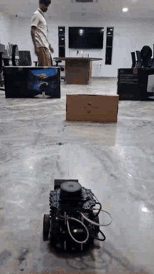
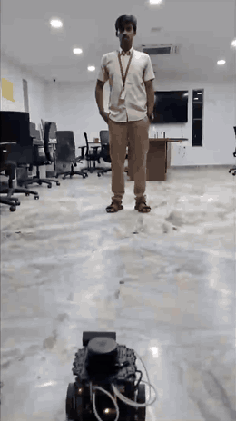
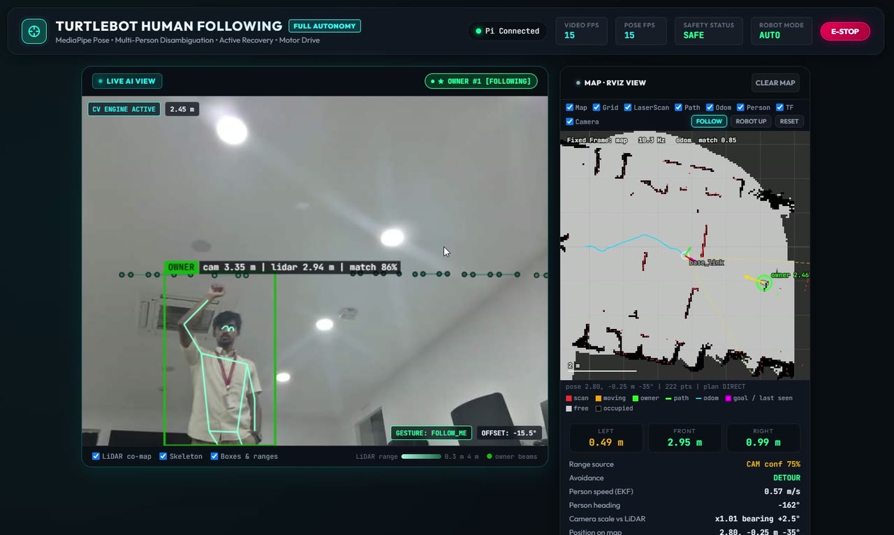
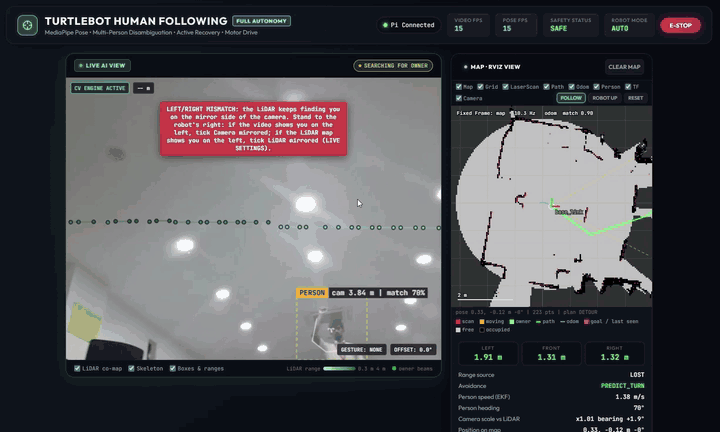

# Vision Based Human Following Robot

A TurtleBot3 Burger that follows one person. Raise a hand and it follows you. Raise both and it stops.
The laptop does the vision and planning. The Raspberry Pi streams the camera and LiDAR and drives the wheels.

| Getting round a box | Follow and stop |
|:---:|:---:|
|  |  |
| 4x speed | 2.5x speed |

Full recordings are in [`videos/`](videos/).

## Dashboard



When the camera loses the owner, the robot plans a path on the LiDAR map to where it last saw them (3x speed):



## Gestures

| You | Robot |
|---|---|
| Raise one hand above your head, first time | Enrols you as the owner |
| Hold a hand above your shoulder | Follows |
| Lower your hand | Stops and keeps facing you |
| Raise both hands | Stops until the owner raises one hand again. Works for anyone |
| Cross your arms | Forgets the owner |

## How it works

```text
camera + LiDAR  ──>  Raspberry Pi  ──UDP──>  laptop
wheels  <──  OpenCR  <──  Raspberry Pi  <──UDP──  velocity
```

- MediaPipe Pose finds people. A colour histogram of the clothing tells the owner apart.
- A Kalman filter combines the camera and LiDAR estimates of the owner's position.
- A PID controller keeps the distance (2 m by default).
- If the owner disappears, A* plans to their last position, then the robot rotates to search.
- The LiDAR stops forward motion at 0.20 m. The Pi stops the wheels after 0.35 s without a command.

## Hardware

- TurtleBot3 Burger with OpenCR, Raspberry Pi 4 and LDS-02 LiDAR
- USB camera
- Laptop (CPU is enough)
- On the Pi: Ubuntu 22.04 and ROS 2 Humble

## Run it

Laptop and Pi must be on the same network.

**1. Install on the laptop**

```powershell
git clone https://github.com/GSRISHANTH/Human-Following-Turtle-bot.git
cd Human-Following-Turtle-bot
py -3.11 -m pip install -r requirements.txt
```

**2. Start the robot**

```bash
scp -r pi ubuntu@<PI_IP>:~/
ssh ubuntu@<PI_IP>
python3 -m pip install --user -r ~/pi/requirements.txt
bash ~/pi/start_robot.sh
```

**3. Start the dashboard**

```powershell
$env:PI_IP = "<PI_IP>"
py -3.11 app.py
```

Open <http://localhost:8000>. If no video appears, allow inbound UDP port 5000 for Python in Windows Firewall.

**Without the robot:** `run_hil.bat` uses the laptop webcam and a simulated Burger.

**Tests:** `py -3.11 -m unittest discover tests` runs 161 tests. None of them move the robot.

## Settings

Change them in the dashboard under **Live Settings**, or copy `config.example.json` to `config.local.json`
and edit it. All options are in [`laptop/config.py`](laptop/config.py).

## Troubleshooting

| Problem | Check |
|---|---|
| No video | The Pi node is running, `PI_IP` matches `hostname -I` on the Pi, UDP 5000 is allowed |
| Wheels do not move | OpenCR power switch is on and the battery is above 11 V |
| Left/right mismatch warning | Camera and LiDAR orientation settings, and the camera's mounting angle |

## Known issues

- The camera pitch must be measured and set (`CAM_PITCH_DEG`), or LiDAR points do not line up with the video.
- One person is sometimes detected twice, which causes a brief "two look-alikes" hold.
- A stop gesture can trigger by mistake when you are at the edge of the picture.

## Reference

F. Rollo et al., [FollowMe: a Robust Person Following Framework Based on Visual Re-Identification and Gestures](https://arxiv.org/abs/2311.12992), IEEE ARSO 2023.

[MIT License](LICENSE)
